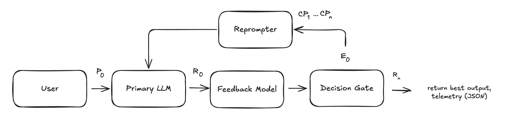

# reprompting-pipeline

Make any LLM follow instructions better, without retraining it.

The pipeline asks your model for an answer, has a second LLM (the **judge**) audit that answer, and, if the audit finds problems, sends the model a targeted correction prompt. It repeats until the answer passes or a limit is reached, then returns the best answer it saw.

It treats your model as a black box: you give it a plain Python function, so it works with OpenAI, Anthropic, Together, a local model, or anything else.



1. **Generate:** your prompt goes to your LLM, producing a first response.
2. **Judge:** a small Together AI model checks the response for instruction adherence, groundedness (hallucination against your context) and toxicity, and explains each failure.
3. **Re-prompt:** a corrective prompt is built from the failures ("you violated X because Y; keep doing Z").
4. **Refine:** your LLM revises; the loop repeats until all checks pass, `max_iterations` is hit, or the latency budget runs out.

## Install

```bash
git clone https://github.com/ashah-aanya/reprompting-pipeline.git
cd reprompting-pipeline
pip install -e .
export TOGETHER_API_KEY=...   # used by the judge
```

Python 3.10+. The only runtime dependency is the [`together`](https://pypi.org/project/together/) SDK (2.x).

## Quick start

```python
import os
from together import Together
from reprompting_pipeline import RepromptingConfig, run_reprompting_pipeline

client = Together(api_key=os.environ["TOGETHER_API_KEY"])

# Your model, as a function. The pipeline hands you a prompt template to fill in.
def my_llm(template, system_prompt, context, user_query) -> str:
    prompt = template.safe_substitute(system_prompt=system_prompt, context=context, user_query=user_query)
    reply = client.chat.completions.create(
        model="meta-llama/Meta-Llama-3.1-8B-Instruct-Turbo",  # any chat model you like
        messages=[{"role": "user", "content": prompt}],
        max_tokens=256,
        temperature=0,
    )
    return reply.choices[0].message.content

result = run_reprompting_pipeline(
    llm_fn=my_llm,
    user_query="Tell me about the Orion X1.",
    context="The Orion X1 laptop has a 14-inch display, 16 GB of RAM and a 10-hour battery.",
    user_instructions=["Answer in at most two sentences.", "Do not mention price."],
    reprompting_config=RepromptingConfig(max_iterations=3, return_telemetry=True, return_summary=True),
)

print(result["summary"])        # e.g. "2 iterations, 0 failed instructions remaining"
print(result["best_response"])
```

Write instructions that are **specific and checkable** ("at most two sentences", "start with Yes or No"). Vague or contradictory instructions can't be fixed by re-prompting.

## Configuration

`RepromptingConfig` (all fields optional):

| Field | Default | Meaning |
|---|---|---|
| `max_iterations` | `2` | Max LLM calls: 1 initial + re-prompts. Must be ≥ 1. 2-3 is a good range. |
| `latency_limit_ms` | `None` | Stop re-prompting once 75% of this budget is used. |
| `together_api_key` | env `TOGETHER_API_KEY` | Key for the judge. Only read when the judge is created. |
| `judge_model` | see `config.py` | Together model that audits responses. |
| `judge_max_tokens` / `judge_temperature` | `1500` / `0.0` | Judge generation settings. |
| `return_telemetry` | `False` | Add per-iteration details to the result. |
| `return_summary` | `False` | Add a one-line summary to the result. |
| `user_model_max_retries` | `2` | Total attempts (exponential backoff) for each `llm_fn` call. |
| `feedback_model_max_retries` | `2` | Total attempts (exponential backoff) for each judge call. |

`run_reprompting_pipeline` returns `{"best_response": str, "telemetry": [...]?, "summary": str?}`. Full details are in [docs/reprompting.md](docs/reprompting.md).

## Bring your own judge

The judge is one small interface: any object with `evaluate(payload) -> JudgeResult`. Pass it as `judge=` to use another model or provider, or a fake in tests. See [docs/judge.md](docs/judge.md) for the report format, the prompt, and how to measure and tune a judge with the included eval set.

## Status and honest limitations

- **The judge is an LLM, not a calibrated classifier.** Its probabilities are the model's own estimates, and the thresholds (adherence passes at 0.5, toxicity fails above 0.25) were inherited from the pipeline's original detector. Measure your judge model with `evals/run_judge_eval.py` before relying on it.
- Subjective goals (tone, creativity) improve inconsistently.
- Every iteration costs one LLM call plus one judge call, so latency and cost grow with `max_iterations`.
- No benchmark results are published for this version of the judge.

## Development

```bash
pip install -e ".[dev]"
pytest                                  # offline: fake judge, no network (live tests are skipped without a key)
TOGETHER_API_KEY=... pytest -m integration -s
python evals/run_judge_eval.py --dry-run
```

## Origin

I built the first version of this pipeline as the re-prompting API during my internship at AIMon (summer 2025), as part of AIMon's open-source Python SDK, where it called AIMon's hosted detector. This repository is an independent, standalone continuation: it extracts that code and replaces the detector with the LLM judge in `src/reprompting_pipeline/judge.py` (Together AI), so it keeps working on its own.

This project is not affiliated with or endorsed by AIMon.

**About the git history.** The commits from July 2025 are the original development history, extracted from the SDK repository with `git filter-repo` and limited to the re-prompting code. Commit hashes therefore differ from the originals, and the author email was replaced with a GitHub noreply address; dates, authorship and commit contents are preserved (a few messages were lightly reworded to remove names and links). The standalone port to Together AI is the most recent commit, from October 2026.

## License

MIT, see [LICENSE](LICENSE).
