# Re-Prompting: A Smarter Loop for Smarter Models

By Aanya Shah. First published at [ashah-aanya.github.io/re-prompting.html](https://ashah-aanya.github.io/re-prompting.html); written during my internship at AIMon in summer 2025.

> **Read this first.** This is the original technical blog post, reproduced as written. Its results (the ~22% improvement, the 1,000-sample dataset, the latency numbers) were measured in 2025 with **AIMon's Instruction Following Evaluation (IFE) model** as the feedback model. This repository replaces that model with an LLM judge running on Together AI, so **those numbers describe the original system, not this repository's judge, and have not been reproduced here.** Links to AIMon's GitHub repository below point to the original location, which may no longer be available; this repository is the standalone continuation. For ways this implementation differs from the post, see [reprompting.md](reprompting.md#differences-from-the-original-blog-post).

## Overview

What if your Large Language Models (LLMs) could rewrite its own answers until it got things right … *automatically?*

Anyone who’s worked with LLMs knows the drill. You give a model a prompt with specific instructions and still, the response comes back missing something. So you tweak the prompt and try again, asking it to fix the tone, then rephrase for conciseness. Eventually, you may get what you need but only after multiple rounds.

Re-prompting automates that loop. Instead of relying on massive models with high latency or manually fine-tuning outputs, we introduce a lightweight, stateless system that sits on top of any black-box LLM. Using AIMon’s [Instruction Following Evaluation (IFE)](https://www.aimon.ai/announcements/ife-200ms-instruction-following-evaluation-for-agentic-reflection/) model to give precise feedback, our system generates a targeted corrective prompt to extract better outputs.

In this blog, we will walk you through

- **How the re-prompting loop works**
- **How it performs across different model sizes and vendors** (how small models (3-24B parameters) can rival GPT 4o)
- **Which types of instructions this system fixes best**, and where it still struggles

## Goals

Our system is designed to:

- Boost instruction adherence
- Minimize hallucinations
- Flag and fix toxicity
- Stay fast and token-efficient
- Keep all models stateless for scalability

## How it Works: The Re-prompting Loop

Think of our system as an editorial feedback loop for LLM responses. With each pass through, the original LLM draft is reviewed and returned with targeted feedback to fuel iterative improvement until it converges on an error-free output. Each iteration can optionally log a JSON blob of diagnostics for iteration progression, providing full transparency into how the model evolves with each re-prompt.

#### Workflow:

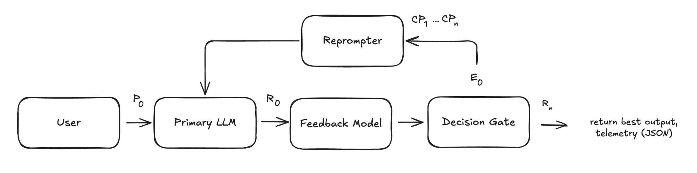

### Step 1: Draft the Initial Response (P₀ → R₀)

The user sends a query, context, and instructions to a stateless LLM that generates a response that may fail to fully comply with the provided, especially critical, instructions.

### Step 2: Audit with the Feedback Model (R₀ → E₀)

While the base LLM focuses on *creation,* we leverage AIMon’s Instruction Following Evaluation model here to focus on *correction*. IFE runs 10× faster than the LLM thanks to its compressed output representation and provides a structured error report with (a) instruction, (b) follow probability (FP), (c) natural language explanation. We used it to assess:

**Groundedness:** evaluates factual consistency to measure whether a model’s generated response remains faithful to the input context and avoids hallucinations or speculative reasoning

> **Example Failure**
>
> The generated text misinterprets the context.
>
> **Context:** “The Eiffel Tower is located in Paris, France. It was completed in 1889.”
>
> **Generated Text:** “The Eiffel Tower, located in Berlin, France, was completed in 1890.”

**Instruction adherence:** evaluates whether a model’s response follows a set of provided or implied instructions (e.g.: formatting constraints, tone specifications)

> **Example Failure**
>
> The generated text fails to follow the specified format.
>
> **Query:** “Summarize the plot of *The Lion King*.”
>
> **Instruction:** “Use bullet points.”
>
> **Generated Text:** “The Lion King is about Simba, who flees after his father dies. Later, he comes back to defeat Scar and reclaim his place as king.”

**Toxicity:** evaluates whether a generated response contains harmful, unsafe, or offensive language

The feedback model only sees the current draft, enabling safe, horizontal scaling with no cross-session leakage.

### Step 3: Generate a Corrective Prompt (En → Pn)

We embed IFE’s targeted feedback in a Corrective Prompt (CP). The CP must balance clarity and brevity: too terse and the model misses nuances; too verbose and we waste tokens or confuse smaller models. Because the LLM is stateless, the CP reiterates background information like the query. We implemented the following structure:

```
Revise your previous response to this query:

[user query]
Context:
[context]
Previous response:
[generated text]
if failed instructions >= 3:
         Your reply had major issues. Fix all points below.
if failed instructions between 2 and 3:
        Some parts were off. Improve using the notes below.
if less than 2:
        Almost there! Just a few small fixes needed.
Fix the following:
1. We are [1-FP*] confident that the following instruction was not followed:
→ Violated Instruction: [instruction]
→ Explanation: [explanation]
…
Preserve correct content. Return only the revised output with no extra explanation.
You did well on these instructions. It is important that you continue to follow these instructions:
[followed instructions]
* FP = follow probability (IFE confidence that a given instruction was adhered to)
```

Design Considerations:

- **Tone adjustment:** Tone becomes stricter with increasing error severity
- **Divulge follow confidence:** reveals IFE’s follow probabilities to clarify confidence in instruction violation to prevent overcorrection
- **Prioritized ordering**: Sorts violations by increasing follow probability to target the most certain and critical issues first
- **Targeted feedback:** Includes IFE’s explanations to guide precise revisions

### Step 4: Iterative Refinement (P₁ → R₁ … Pₙ → Rₙ).

We repeat steps 2–4 until we either

- Hit a maximum of **N iterations** (default: 3), or
- Achieve a clean run with no hallucinations, toxic content, or broken instructions (where the follow probability for each instruction and groundedness is >= 0.5 and toxicity is < 0.25)

To choose the best response, we score each draft with a **residual error metric**, giving more weight to the most egregious mistakes. A score close to 0 means high-quality output while closer to 1 means poor instruction-following. For each instruction:

- If follow probability ≥ 0.5 → penalty = 0
- If follow probability < 0.5 → penalty = 2 × (1 − p)

Then: Residual Error = Average of all penalties across groundedness and instruction adherence

Once the loop exits, the draft (R0 … R3) with the least failed instructions is surfaced to the user. If tied, the draft with the lowest residual error score is returned. The result? Ideally, a fully instruction-adherent output. But does it actually deliver? Let’s find out!

## Dataset Details

In order to test our re-prompting workflow, we assembled a 1000 sample dataset on customer support use cases across bureaucratic, legal, and technical domains to stress-test instruction-following on complex, rule-heavy contexts. We initially hand-curated 25-50 samples and scaled using AIMon’s Data Foundry tool.\*

*\*AIMon's Data Foundry Tool automatically expands reference samples across multiple axes to generate a high quality dataset. More details will be shared in an upcoming blogpost.*

Each sample has the following:

**Context:** A document about company or topic policy, history, or rules, sourced from real-world materials such as:

- Company policies (e.g.: [Apple](https://www.apple.com/iphone/), [Amazon](https://www.amazon.com/gp/help/customer/display.html?nodeId=G6LDPN7YJHYKH2J6))
- Regulations (DMV, student aid, health insurance) \[[link](https://huggingface.co/datasets/IBM/doc2dial)\]
- Financial platforms (e.g.: [Robinhood](https://cdn.robinhood.com/assets/robinhood/legal/RAM_Brochure_and_Brochure_Supplements.pdf))
- Technical docs (e.g.: [Metaflow](https://docs.metaflow.org/), [Ray](https://docs.ray.io/en/latest/ray-core/walkthrough.html))

**Query:** A user question related to the provided context.

**Instructions:**

To evaluate how re-prompting performs across different instruction types, we defined common categories and gave each sample a fixed number of instructions of each type, totaling 20 instructions per sample. Instructions were a mix of user-written and AIMon-provided. Here are the categories we outlined:

User-simulated (individual instructions varied across samples)

1. **Tone (2 instructions per sample)** Specifies emotional or stylistic voice (e.g., friendly, formal)
2. **Format (1)** Controls layout (bullets, steps, etc.)
3. **Content requirements (2)** Defines required elements (e.g., definitions, exceptions, form numbers)
4. **Brand reputation (1)** Aligns with company voice and disclaimers
5. **Completeness (2)** Promotes full response to multi-part queries
6. **Conciseness (1)** Promotes brevity

AIMon provided (constant across samples)

1. **Groundedness (5\*)** Ensures responses stay faithful to the context and avoid hallucinations
2. **Toxicity (6\*)** Prevents harmful, unsafe, or offensive content

*\*Groundedness and Toxicity metrics each have multiple different instructions evaluating different aspects of the metric*

In order to ensure high data quality, we had a panel of 3 LLM judges (GPT-4o, Llama 3.3 70B Instruct Turbo, Claude Opus 4) score each sample from 1-10 per metric, using a majority vote to assign final scores. We applied two filtering metrics (score > 6) to all 1000 samples to avoid setting models up for failure:

- **Instruction relevance:** Are the instructions clear, specific, and actionable?
- **Instruction compatibility:** Can all instructions be followed without conflict?

We then randomly selected 100 samples (10%) for deeper evaluation using the following metrics to ensure dataset diversity and used few-shot prompting to guide consistent scoring:

- **Context-query relevance:** Does the context sufficiently support the query and instructions?
- **Context quality:** Is the context clear, well-structured, and easy to interpret?

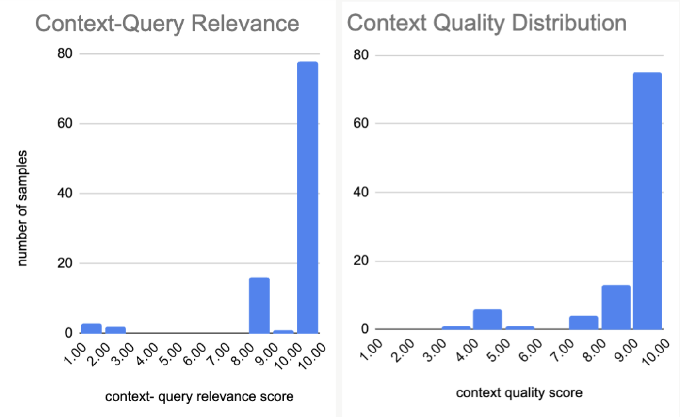

We also attempted to quantify the difficulty of answering the query while following all instructions given the context by using Llama 3.3 70B Instruct Turbo to assign a difficulty score to each sample. We intentionally opted against using larger models like GPT-4o for this step because they often underestimate difficulty for the smaller parameter models that we are re-prompting.

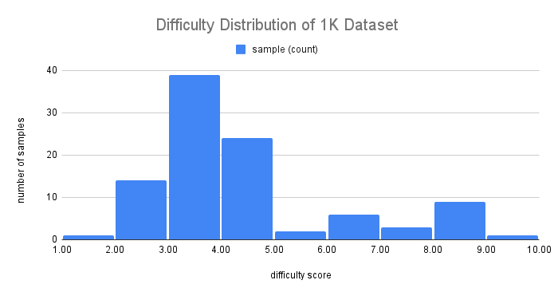

The chart shows the distribution of difficulty across our full 1K-sample dataset. Most samples fall in the 2–4 range, representing relatively straightforward tasks, though there’s a meaningful tail of more complex examples.

Later, we expanded our dataset by creating a 100-sample “difficult set” composed by using the AIMon Data Foundry tool to expand samples that required re-prompting. In the chart below, red bars show this set’s difficulty distribution versus 100 randomly extracted samples from the original 1K dataset (blue). As expected, the hard set skews higher, but some low-scored samples (e.g., difficulty 2) still caused failures, highlighting that these assigned difficulty scores don’t always align with real model struggles.

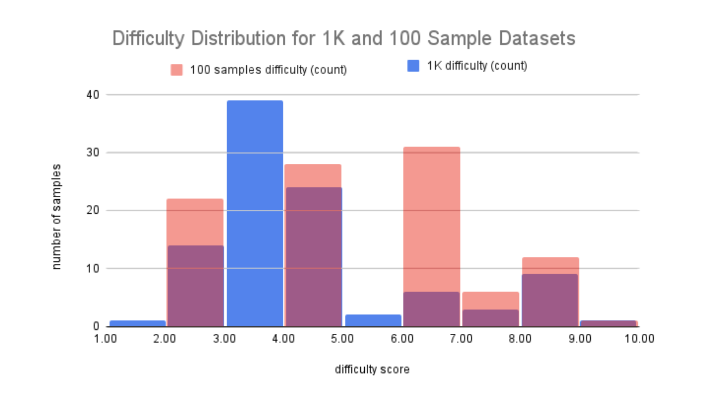

## Results

### Did re-prompting work?

To find out, we tested our 1K dataset across several models and tracked their instruction following rate, the percentage of samples where the final draft satisfied all provided instructions, before and after re-prompting. As a baseline, we ran the same samples on GPT-4o without any re-prompting (shown as the green dotted line in the chart below).

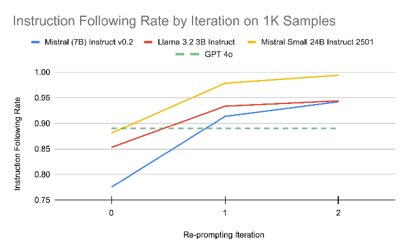

As shown, while most models initially underperformed GPT-4o, re-prompting allowed every model to surpass GPT-4o’s baseline. Larger models like Mistral 24B were able to better implement feedback and achieve a higher per-iteration increase in instruction following rate. Furthermore, we can see diminishing returns with successive re-prompts.

[Example Reprompting Flow →](https://canva.link/25z15yxdf68dhvu)

We used the same three judges as above to serve as a soft validation to check for any failed instructions in 20 re-prompted samples per base LLM where all instructions were marked as adhered to. The panel largely confirmed the IFE model’s assessments, with only a 4% disagreement rate, primarily on subjective metrics such as conciseness and completeness. Even with a ±4% confidence margin, the results show that re-prompting has a distinctly positive effect on instruction adherence.

We also ran our “difficult set” of 100 samples on multiple models, again using GPT-4o as the reference baseline (shown as the green dotted line in the chart below). We also experimented with running re-prompting on GPT-4o (green line) and saw a rapid improvement in instruction following rate after just 1 iteration. This also supports the validity of the samples as a fully instruction-adherent output is possible.

To test reproducibility, we ran Qwen 7B twice (blue and orange) and observed nearly identical starting adherence and post re-prompting improvements (even if it varied in the intermediate), suggesting the process produces stable, repeatable results even on smaller models.

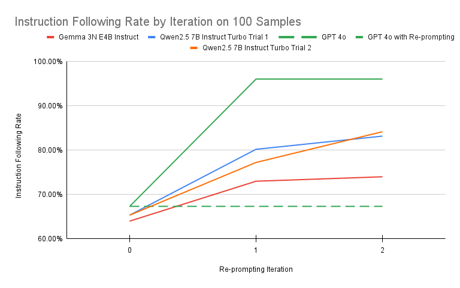

We also computed the average iterations to convergence to see how many rounds were required to get a fully instruction-adherent draft. For all models, this averaged between 1 and 2 iterations, with the models run on the harder 100 sample test set requiring a higher average number of iterations:

**Average Iterations for Convergence with Re-prompting**

| Mistral (7B) Instruct v0.2 | Llama 3.2 3B Instruct | Mistral Small 24B Instruct 2501 | Gemma 3N E4B Instruct | Qwen2.5 7B Instruct Turbo |
|---|---|---|---|---|
| 1.33 | 1.23 | 1.15 | 1.64 | 1.55 |

### Instruction-Level Analysis

To understand where re-prompting helped most, we examined the fix rate per instruction type: the percentage of initially violated instructions that were later satisfied on a per-category basis. You can see a description of each of the instruction categories above in the dataset section.

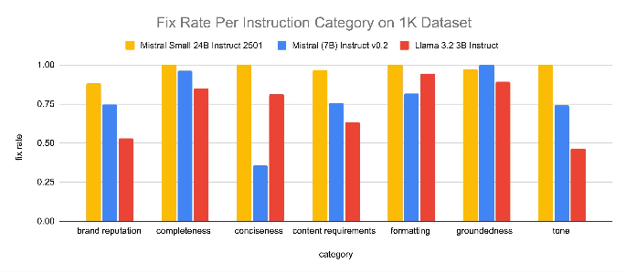

Re-prompting was especially effective at resolving groundedness violations (hallucinations), thanks to IFE’s precise token-level feedback. However, more subjective instructions like conciseness proved harder to fix consistently. It is also important to consider that the number of instruction failures in each category also varied.

In the graph below you can see the percent of each type of instruction that adhered initially, adhered after re-prompting, and failed despite re-prompting. Note the scale of the graph is 85% to 100% of total instructions in a given category across all samples.

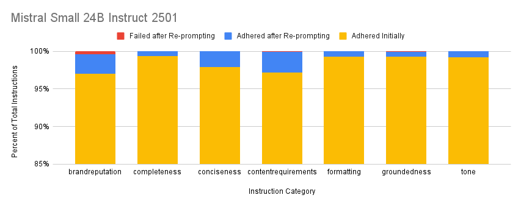
*mistral small 24B instruct*

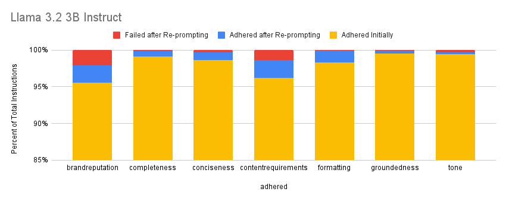
*llama 3b instruct*

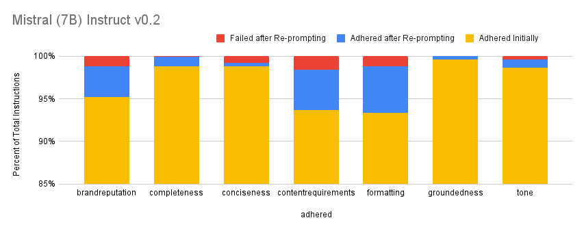
*mistral 7b instruct*

Content requirements (“Include a clear recommendation or suggested course of action based on the context.” frequently failed) and brand reputation instructions (“Avoid expressions of uncertainty about company policies and eliminate vague or speculative phrases (e.g., “I think we cover that”)”) had the highest failure rates, and while re-prompting improved adherence, these categories remained more difficult to fix compared to others. In contrast, formatting violations, though common, were more reliably corrected after re-prompting.

We also evaluated the break rate: the percentage of instructions that were initially followed but later broken after re-prompting across different models.

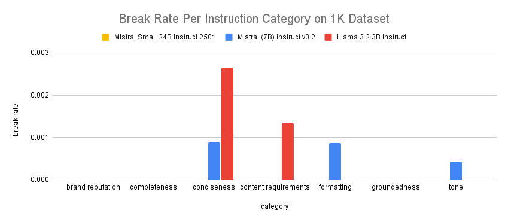

Break rates were very low across the board. Since we always select the response with the fewest failed instructions (or lowest residual error score when tied), re-prompting delivers a neutral-to-positive net effect on overall output quality, though it may occasionally sacrifice adherence of one instruction for higher adherence of the rest.

### Latency

Re-prompting yields some interesting results, but how practical is this strategy? This graph shows average end-to-end latency (with 95% confidence intervals) across all samples, comparing outputs with and without use of the re-prompting pipeline. The “after re-prompting” values reflect the overall average across all queries, including those resolved on the first pass (and thus requiring no re-prompting) and those requiring multiple iterations.

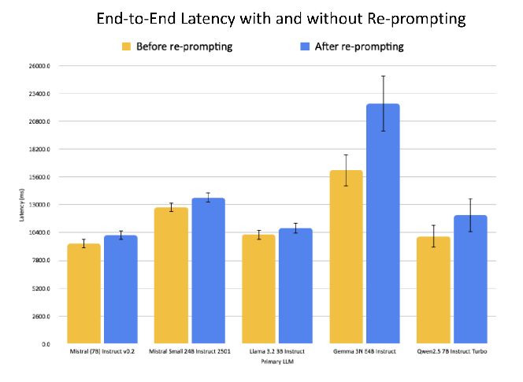

For models like Mistral 24B, which required minimal re-prompting, the latency increase was small for the overall dataset. In contrast, models such as Gemma 4B, which needed multiple re-prompting rounds due to lower initial instruction adherence, exhibited a higher average latency. However, samples that required re-prompting exhibited an average of a 5,121.2 ms increase in latency (roughly a 47% increase), reflecting the extra workload of recalling the primary LLM up to two additional times. However, because many queries will adhere to instructions on the first pass (requiring no re-prompting), the overall impact on large-scale workloads is much less pronounced. Additionally, the 95% confidence intervals for almost all models overlap, indicating that this added latency is statistically negligible when viewed across many LLM calls.

### Limitations

While re-prompting significantly improves instruction adherence, its effectiveness depends heavily on the quality of the original instructions. Instructions must be clear, deterministic, and realistically followable as vague or contradictory guidance cannot be reliably corrected. More subjective dimensions, such as tone or conciseness, show inconsistent improvements and are harder to quantify. Additionally, there is a hit to latency and a tradeoff between quality and speed to consider, especially for real-time or cost-sensitive applications.

## Conclusion

Ultimately, re-prompting did boost instruction-following rates by ~22% on average. If you want to try it yourself, check out AIMon’s [open-source framework and API](https://github.com/aimonlabs/aimon-python-sdk) to integrate re-prompting into your workflows.
